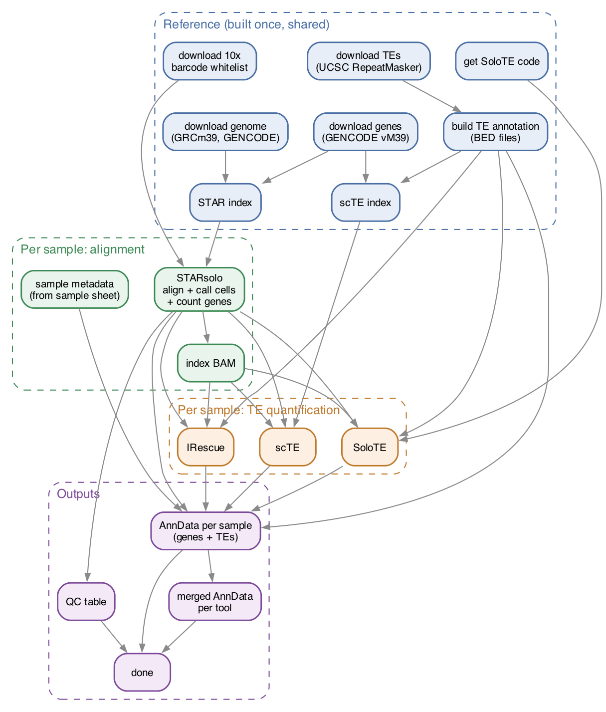

# sctequant: transposable elements in single-cell RNA-seq

sctequant counts **transposable element (TE)** expression in 10x Genomics
single-cell RNA-seq data from **mouse (mm39)**. It runs on Mount Sinai's
**Minerva** cluster.

You give it **a folder of FASTQ files** and **a sample sheet**. It gives you
**AnnData (`.h5ad`) files** with gene and TE counts for every cell, ready for
Scanpy (or Seurat).



The reference steps (blue) run once and are reused by every later run. The
green and orange steps run once per sample, in parallel.

Three TE tools are run because they make different choices about
multi-mapping reads, and comparing them tells you how robust a result is:

| Tool | What it counts | Multi-mapping reads |
|---|---|---|
| [SoloTE](https://github.com/bvaldebenitom/SoloTE) | TE subfamilies (or individual loci) from reads **not** in genes | uniquely mapped reads → locus; others → subfamily |
| [scTE](https://github.com/JiekaiLab/scTE) | TE subfamilies; reads in gene exons go to the gene first | one alignment per UMI |
| [IRescue](https://github.com/bodegalab/irescue) | TE subfamilies | shared between candidate TEs (EM), so counts can be fractions |

---

## Contents
1. [One-time setup](#1-one-time-setup)
2. [Try it on the test dataset](#2-try-it-on-the-test-dataset)
3. [Run it on your own data](#3-run-it-on-your-own-data)
4. [What you get](#4-what-you-get)
5. [Opening the results](#5-opening-the-results)
6. [When something goes wrong](#6-when-something-goes-wrong)
7. [Details for the curious](#7-details-for-the-curious)

---

## 1. One-time setup

Do this once. Log in to Minerva first (`ssh <you>@minerva.hpc.mssm.edu`).

**a) Get conda** (skip if `conda --version` already works). Install
[Miniforge](https://github.com/conda-forge/miniforge) in your home or work
folder, e.g.:

```bash
cd /sc/arion/work/$USER
wget https://github.com/conda-forge/miniforge/releases/latest/download/Miniforge3-Linux-x86_64.sh
bash Miniforge3-Linux-x86_64.sh -b -p /sc/arion/work/$USER/miniforge3
/sc/arion/work/$USER/miniforge3/bin/conda init bash
```
Log out and back in.

> **Minerva tip: keep conda's download cache in project space.** Your work
> folder has a small quota, and conda's cache fills it fast ("Disk quota
> exceeded"). Do this once:
> ```bash
> mkdir -p /sc/arion/projects/<your_lab>/<you>/conda_pkgs
> conda config --add pkgs_dirs /sc/arion/projects/<your_lab>/<you>/conda_pkgs
> conda config --remove channels defaults; conda config --set channel_priority strict
> ```
> If conda fails with "Resource temporarily unavailable" on a login node, run
> the install from an interactive job instead
> (`bsub -P <account> -q interactive -n 2 -W 2:00 -Is /bin/bash`).

**b) Download the pipeline** into your project folder:

```bash
cd /sc/arion/projects/<your_lab>/<your_folder>
git clone https://github.com/singhbhavya/sctequant.git
cd sctequant
```

**c) Create the environment that runs the pipeline:**

```bash
conda env create -f environment.yaml
```

From now on, start every session with:

```bash
conda activate sctequant
```

> Already have a Snakemake environment? It needs Snakemake 8.6 or newer, the
> LSF plugin, and conda 24.7.1 or newer inside it:
> `conda install -c conda-forge -c bioconda snakemake-executor-plugin-lsf "conda>=24.7.1"`

You do **not** need to install STAR, SoloTE, scTE or IRescue yourself. The
pipeline installs them the first time it runs.

---

## 2. Try it on the test dataset

This uses a small public 10x dataset (1,000 mouse brain cells, trimmed to 4
million reads) to check that everything works.

```bash
./test/download_test_data.sh      # ~5 minutes
./run_pipeline.sh check --test    # shows what will run
./run_pipeline.sh --test          # runs it
```

The **first** run also downloads the mm39 genome and builds the STAR index,
which takes a few hours. Later runs reuse it (see `reference_dir` below).
Results appear in `test/results/anndata/`.

---

## 3. Run it on your own data

### Step 1: Make a sample sheet

A CSV file (you can make it in Excel and "Save as CSV"), one row per 10x
library:

| sample | folder | age | condition |
|---|---|---|---|
| sample1 | sample1_fastqs | young | control |
| sample2 | sample2_fastqs | old | treated |

- **sample** (required): a short unique name. Letters, numbers, `_`, `-`, `.` only.
- **folder** (optional): the sub-folder of your FASTQ folder that holds this
  library's FASTQs. If you leave this column out, the pipeline looks for a
  folder named after the sample, or for files starting with `<sample>_`.
- **chemistry** (optional): only if your samples use different 10x kits.
- **Any other columns** (age, sex, condition, …) are copied into the AnnData
  so you can use them in your analysis.

Save it as `config/samples.csv`. See `config/samples_example.csv`.

> **Already have a metadata sheet with different column names?** You don't
> need to rename them. Set `sample_sheet_columns` in the config (see below),
> and use `sample_filter` to run only some rows (e.g. one tissue).

### Step 2: Edit `config/config.yaml`

Open it in any text editor (`nano config/config.yaml`) and replace every
`CHANGE_ME`:

| Setting | What to put |
|---|---|
| `fastq_dir` | folder with your FASTQs |
| `sample_sheet` | your sample sheet (default `config/samples.csv`) |
| `chemistry` | your 10x kit (see below) |
| `lsf: account` | your Minerva allocation, e.g. `acc_YourLab` |
| `reference_dir` | shared lab folder for the genome + index (ask the lab first; one copy is enough) |

**Which chemistry?** Ask whoever made the libraries, or run:

```bash
./check_chemistry.sh /path/to/one/sample/folder
```

| Kit | `chemistry` |
|---|---|
| Single Cell 3' v2 | `10x_3prime_v2` |
| Single Cell 3' v3, v3.1 | `10x_3prime_v3` |
| GEM-X 3' v4 | `10x_3prime_v4` |
| Single Cell 5' v1, v1.1, v2 (incl. V(D)J kits) | `10x_5prime` |
| GEM-X 5' v3 | `10x_5prime_v3` |

The matching 10x barcode whitelist is downloaded automatically.

### Step 3: Check, then run

```bash
conda activate sctequant
./run_pipeline.sh check     # catches typos in paths/sample names; runs nothing
./run_pipeline.sh           # starts the pipeline
```

`./run_pipeline.sh` first installs software and downloads references (first
time only), then submits the pipeline to LSF as a job called `sctequant`.
**You can log out**; it keeps running.

| To… | Run |
|---|---|
| see if it's running | `bjobs` |
| watch progress | `tail -f logs/sctequant_*.log` |
| stop it | `bkill -J sctequant` |
| restart after a failure or stop | `./run_pipeline.sh` again (finished steps are skipped) |

Roughly: ~6–12 hours per run of samples (they run in parallel), plus a few
hours the very first time to build the reference.

---

## 4. What you get

```
results/
├── anndata/
│   ├── solote_all_samples.h5ad    ◄── start here: all samples, one tool
│   ├── scte_all_samples.h5ad
│   ├── irescue_all_samples.h5ad
│   └── solote/sample1.h5ad …      (one file per sample)
├── qc/starsolo_summary.csv        reads, mapping rate, cells found per sample
├── sample1/
│   ├── starsolo/                  BAM + gene matrices (Solo.out/Gene/filtered)
│   ├── solote/  scte/  irescue/   raw output of each TE tool
├── logs/                          one log per step per sample
└── benchmarks/                    time & memory per step
```

Each AnnData contains:

- **cells** (`.obs`): the cells STARsolo called, named `<sample>_<barcode>`,
  with your sample sheet columns plus `gene_counts`, `te_counts`, `pct_te`.
- **features** (`.var`): genes and TEs. `feature_type` is `Gene Expression`
  or `TE`, and TEs also have `te_family` and `te_class` (LINE, SINE, LTR, DNA…).
- **counts** (`.X`): raw counts. Gene counts are the same in all three files
  (from STARsolo); only the TE counts differ between tools.

---

## 5. Opening the results

**Python / Scanpy**

```python
import scanpy as sc
adata = sc.read_h5ad("results/anndata/solote_all_samples.h5ad")

tes = adata[:, adata.var.feature_type == "TE"]
adata.obs.groupby("age")["pct_te"].median()
```

**R / Seurat**: use [zellkonverter](https://bioconductor.org/packages/zellkonverter/)
(`readH5AD()`), or [SeuratDisk](https://github.com/mojaveazure/seurat-disk).

---

## 6. When something goes wrong

| Message / problem | What to do |
|---|---|
| `PROBLEM: ...` when running `check` | Read the message: it names the file, folder or sample at fault. |
| `snakemake not found` | `conda activate sctequant` |
| `Directory cannot be locked` | A previous run crashed. `./run_pipeline.sh unlock`, then run again. |
| A step failed | Run `ls -t results/logs/*/ \| head` and open the newest log for that sample. |
| Very few cells, or low "Reads With Valid Barcodes" in `qc/starsolo_summary.csv` | Wrong chemistry. Run `./check_chemistry.sh` on that sample. |
| Out of memory (`TERM_MEMLIMIT` in the log) | Increase `star: mem_mb` in the config (or ask for help). |

---

## 7. Details for the curious

- **Reference**: GRCm39 primary assembly + GENCODE vM39 genes; TEs from the
  UCSC mm39 RepeatMasker track (LINE, SINE, LTR, DNA, RC, Retroposon classes;
  main chromosomes only). URLs are in `config/config.yaml`.
- **Alignment**: STARsolo 2.7.11b with Cell Ranger-like settings
  (`EmptyDrops_CR` cell calling, `1MM_CR` UMI collapsing). Up to 100
  alignments per read are kept so the TE tools can handle multi-mappers.
  For 5′ data, only R2 is aligned (`--soloStrand Reverse`).
- **Chemistry presets** live in `workflow/chemistries.yaml`; add a block there
  for another kit.
- **Software versions** are pinned in `workflow/envs/`. SoloTE and scTE are
  installed from GitHub at fixed commits.
- **Pipeline diagram**: `docs/pipeline.png` (made from `docs/pipeline.dot`).
  For Snakemake's own job-by-job graph of your run:
  `snakemake --dag | dot -Tpdf > dag.pdf`
- **Layout**: `workflow/Snakefile` → `workflow/rules/*.smk`
  (`common` = sample sheet, `references`, `starsolo`, `te_tools`, `anndata`).

### Citations
If you use this pipeline, please cite the tools:
- STARsolo: Kaminow et al., *bioRxiv* 2021
- SoloTE: Rodríguez-Quiroz & Valdebenito-Maturana, *Commun Biol* 2022
- scTE: He et al., *Nat Commun* 2021
- IRescue: Polimeni et al., *NAR Genom Bioinform* 2024
